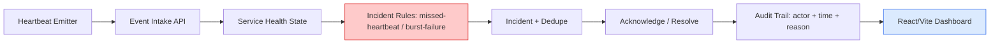

# AgentGuard AI

Monitoring, incident detection and safe recovery (MVP).

## Live Demo

🌐 **[Open the interactive dashboard →](https://bamaboy101.github.io/agentguard-ai/)**

No setup, no credentials, no backend required. Runs entirely in your browser with labeled synthetic data.

---

## What It Delivers

A developer can run fake failing workflows, watch an incident appear, and see an auditable response path on a local dashboard.

**Heartbeat → Incident → Alert → Human Decision.**

- Service registry with heartbeat intake and last-seen health
- Missed-heartbeat and burst-failure detection with deduplication
- Incident lifecycle: open → acknowledge → resolve, with audit trail (actor/time/reason)
- Demo simulator: start/stop/fail a heartbeat emitter and watch incidents fire
- Runbook suggestions and manual acknowledge/resolve controls
- React dashboard with service health, incidents and audit timeline
- **No remote shell, reboot, or production restart**

---

## Architecture



**Trust boundaries:** External recovery actions disabled; approval is a recorded UI decision. Sensitive headers/payloads are not logged. Collector authenticates event writers via a scoped demo token when not in offline mode.

## Demo Preview

The live dashboard at **https://bamaboy101.github.io/agentguard-ai/** shows:

- Service cards (healthy / warning / critical states)
- Simulator buttons: heartbeat, stop, failure
- Incident list with rule, severity, status
- Audit trail table (actor, action, time, note)

> **Screenshot note:** Browser-based screenshot capture is unavailable in this environment. Visit the live demo above to interact with the dashboard directly.

## Features

| Feature | Status |
|---|---|
| Service registry + heartbeat intake | ✅ Verified |
| Missed-heartbeat detection | ✅ Verified |
| Burst-failure detection + dedupe | ✅ Verified |
| Incident lifecycle (open→ack→resolve) | ✅ Verified |
| Audit trail (actor/time/reason) | ✅ Verified |
| Demo simulator | ✅ Verified |
| No remote shell / reboot / auto-restart | ✅ By design |

---

## Installation

```bash
# Clone
git clone https://github.com/bamaboy101/agentguard-ai.git
cd agentguard-ai

# Backend
cd apps/api
npm install          # dev deps include vitest
npm test             # 3 tests pass
npm run dev          # API on :4001

# Frontend (new terminal)
cd ../web
npm install
npm run dev          # Dashboard on :5174

# Docker (optional, once Docker daemon available)
cd ../.. && docker compose up --build
```

Copy `.env.example` to `.env`. Demo needs no credentials.

---

## Configuration

| Variable | Purpose | Required |
|---|---|---|
| `PORT` | API port (default 4001) | No |
| `EVENT_WRITE_TOKEN` | Optional scoped token for event writers | No |
| `N8N_WEBHOOK_URL` | Optional alert webhook target | No |

No credentials are hardcoded, logged, or committed.

---

## Limitations

- Webhook/Telegram delivery with cooldown not included
- Real n8n workflows not included
- Multi-tenant controls and SLO views not included
- No remote shell, reboot, or production restart

---

## Security

- **Recovery actions require explicit approval.** No remote shell, reboot, or production restart.
- **External recovery actions disabled at MVP.**
- **Sensitive headers/payloads are not logged.**
- See `docs/security.md` for details.

---

## Demo

🌐 **[AgentGuard Live Demo](https://bamaboy101.github.io/agentguard-ai/)** — browser-based, no setup, labeled synthetic data.

View source: `https://github.com/bamaboy101/agentguard-ai`

---

## License

[MIT](LICENSE)
